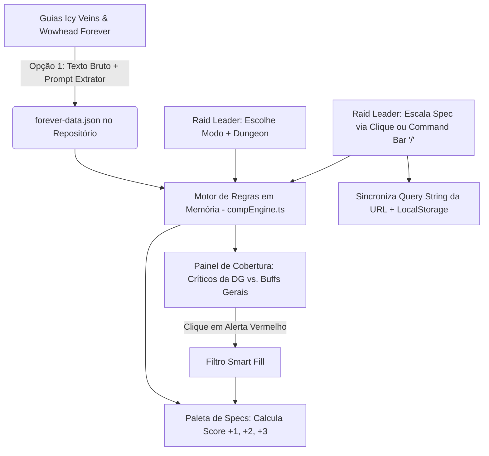

# WoW Forever Comp Builder — Documentação Técnica & Produto

**Versão:** 1.0 (Patch 04/11 - WoW Forever)  
**Status:** Escopo Fechado / Pronto para Desenvolvimento  
**Arquitetura:** SPA Client-Side (Zero-Backend) + JSON Estático Versionado

---

## 1. PRD — Product Requirements Document

### 1.1 Objetivo do Produto
Entregar uma aplicação web de latência zero para Raid Leaders e líderes de grupo montarem composições de **Dungeon (5 jogadores)** e **Raid (10/20/40 jogadores)** baseadas exclusivamente nas regras, classes, especializações e talentos novos do **World of Warcraft: Forever**.

### 1.2 Regras de Negócio Essenciais
1. **Isolamento de Domínio (100% WoW Forever):**
   - Apenas as classes, specs, buffs e utilitários existentes no lançamento do *WoW Forever* entram na base.
   - **Sem seleção de Raças:** O usuário escolhe exclusivamente `Classe + Spec` para manter o fluxo de 1 clique.
   - **Talentos Novos nos Bastidores:** Os talentos novos do *WoW Forever* que concedem utilitários ou buffs na build recomendada dos guias (Icy Veins / Wowhead) já vêm consolidados direto na lista de utilitários da Spec. O Raid Leader não precisa configurar árvores de talentos na tela.
2. **Filtro de Contexto por Dungeon vs. Raid:**
   - **Modo Dungeon (5 jogadores):** Possui um seletor de Masmorras com a opção padrão `"Geral (Todas as Dungeons)"` e as dungeons específicas do *WoW Forever*.
     - *Utilitários Críticos da DG:* Ficam em alerta vermelho se faltarem no grupo (ex: Bloodlust, Battle Res, Interrupt Curto + Dispels letais daquela masmorra).
     - *Demais Buffs de Raid:* Exibidos como bônus de sinergia para maximizar o grupo, sem disparar erro crítico se faltarem.
   - **Modo Raid (10/20/40 jogadores):** Todos os Raid Buffs, Dispels e Utilitários Core tornam-se requisitos obrigatórios no painel principal.
3. **Indicação Ativa por Contagem Pura (Sem Geração Automática):**
   - O sistema nunca monta ou altera o grupo sozinho; ele apoia a decisão do líder.
   - Caso o grupo já tenha 1 ou 2 classes fixas (mesmo fora do meta), o motor calcula os buracos restantes e exibe um **Score de Cobertura (`+1`, `+2`, `+3`...)** em cada card da paleta de specs.
   - **Smart Fill (Filtro Reverso):** Ao clicar em 1 ou mais alertas vermelhos de utilitários faltando, a paleta destaca no topo as specs que cobrem aqueles requisitos específicos, desempatando puramente pela contagem de buracos resolvidos.
4. **Velocidade de Input (Fricção Zero no LFG):**
   - **Command Bar (`/`)**: Permite digitar atalhos (`rsham`, `fdk`, `bm`, `lust`) e teclar `Enter` para alocar a spec imediatamente no primeiro slot compatível com a função (Tank, Healer ou DPS).

### 1.3 Fora de Escopo (Evitando Overengineering)
- Calculadora de árvore de talentos ponto a ponto.
- Seleção de raças ou raciais nos slots.
- Banco de dados relacional, backend de autenticação ou login Battle.net.
- Web scrapers automatizados rodando em servidor.

---

## 2. ADR — Architecture Decision Records

### ADR-01: SPA Estática com Estado na URL (Zero-Backend)
- **Decisão:** Aplicação Front-end pura (React + TypeScript + Vite + Tailwind CSS). Todo o estado da composição (`modo`, `dungeonId`, `slots`) é sincronizado na Query String da URL (`?m=5&dg=general&c=...`) e no `localStorage`.
- **Vantagens:** Custo de nuvem $0,00/mês (Cloudflare Pages ou Vercel), resposta visual em 0ms e compartilhamento direto do link no Discord.
- **Custo/Complexidade:** Exige serialização enxuta na URL para que grupos de 40 jogadores não gerem links gigantes.

### ADR-02: Base de Dados em JSON Estático (`forever-data.json`)
- **Decisão:** Armazenar classes, specs, utilitários e perfis de dungeons em um arquivo JSON tipado dentro do repositório, atualizado via extração assistida dos guias do Icy Veins e Wowhead.
- **Vantagens:** Elimina falhas de scrapers quando o Wowhead muda o layout e dispensa manutenção de API/Banco de Dados.
- **Custo/Complexidade:** Mudanças de balanceamento no jogo exigem atualizar o arquivo JSON e fazer um `git push`.

### ADR-03: Consolidação de Talentos Novos no Catálogo da Spec
- **Decisão:** Em vez de exigir que o usuário ligue/desligue talentos na interface, o processo de extração lê os guias de *WoW Forever* e embute os utilitários provenientes dos novos talentos diretamente no array `utilities` de cada spec.
- **Vantagens:** Mantém o motor de cálculo como uma simples interseção de arrays (`Set`) e preserva a velocidade de uso durante o LFG.
- **Custo/Complexidade:** Assume que o jogador convidado no jogo está usando a build recomendada do guia para entregar aquela utilidade.

---

## 3. Fluxo de Dados e Arquitetura



---

## 4. Contrato de Dados (`src/data/forever-data.schema.ts`)

```typescript
export type RoleType = "TANK" | "HEALER" | "MELEE_DPS" | "RANGED_DPS";
export type UtilityCategory = "CORE" | "DISPEL" | "CC" | "RAID_BUFF";

export interface UtilityDefinition {
  id: string;           // ex: "bloodlust", "poison_dispel", "buff_ap"
  name: string;         // ex: "Bloodlust / Heroism"
  shortName: string;    // ex: "Lust"
  category: UtilityCategory;
  icon: string;
  description: string;
}

export interface SpecDefinition {
  id: string;           // ex: "shaman-resto"
  className: string;    // ex: "Shaman"
  specName: string;     // ex: "Restoration"
  role: RoleType;
  colorHex: string;     // ex: "#0070DD"
  shortcuts: string[];  // ex: ["rsham", "resto", "shaman"]
  utilities: string[];  // IDs de UtilityDefinition (já incluindo talentos novos do Forever)
  notes: string;        // Resumo rápido das ferramentas + talentos novos relevantes
}

export interface DungeonProfile {
  id: string;                  // ex: "general"
  name: string;                // ex: "Geral (Todas as Dungeons)"
  criticalUtilities: string[]; // Ficam vermelhos se faltarem nesta DG
  bonusUtilities: string[];    // Somam na sinergia, mas sem alerta de erro letal
}

export interface ForeverGameData {
  patchVersion: string;
  utilities: UtilityDefinition[];
  specs: SpecDefinition[];
  dungeons: DungeonProfile[];
}
```

---

## 5. Prompt Extrator Oficial (Opção 1: Icy Veins & Wowhead → JSON)

Sempre que quiser popular ou atualizar o arquivo `forever-data.json`, copie o texto das páginas de classes/dungeons do **Icy Veins (WoW Forever)** e **Wowhead (Forever)** e envie com o prompt abaixo:

```text
Você é um extrator de dados técnicos para o sistema "WoW Forever Comp Builder".
Sua única tarefa é ler o texto bruto copiado dos guias oficiais do World of Warcraft: Forever (Icy Veins / Wowhead) abaixo e convertê-lo estritamente para um arquivo JSON válido seguindo o schema do projeto.

REGRAS OBRIGATÓRIAS DE EXTRAÇÃO:
1. CONSIDERE APENAS O WOW FOREVER: Ignore qualquer classe, spec ou mecânica do WoW Retail que não esteja presente no texto fornecido do WoW Forever.
2. IGNORE RAÇAS: Não crie campos de raças ou raciais.
3. EMBUTA OS TALENTOS NOVOS: Se o guia indicar que uma Spec recebe um buff, dispel, stun, interrupt ou utilitário através das novas árvores de talentos do WoW Forever, inclua esse utilitário diretamente no array "utilities" daquela Spec e mencione o nome do talento no campo "notes".
4. CATEGORIAS DE UTILITÁRIOS: Classifique cada utilitário encontrado em "CORE" (Lust, Battle Res), "DISPEL" (Magic, Poison, Curse, Disease, Soothe/Enrage), "CC" (Interrupt curto, AoE Stun/Stop) ou "RAID_BUFF" (Buffs de atributos/dano do grupo).
5. RETORNE APENAS O JSON PURO: Não adicione explicações antes ou depois do bloco JSON.

FORMATO DE SAÍDA ESPERADO:
{
  "patchVersion": "forever-04-11",
  "utilities": [
    { "id": "string", "name": "string", "shortName": "string", "category": "CORE | DISPEL | CC | RAID_BUFF", "icon": "emoji", "description": "string" }
  ],
  "specs": [
    { "id": "class-spec", "className": "string", "specName": "string", "role": "TANK | HEALER | MELEE_DPS | RANGED_DPS", "colorHex": "#HEX", "shortcuts": ["string"], "utilities": ["utility_id"], "notes": "string" }
  ],
  "dungeons": [
    { "id": "general", "name": "Geral (Todas as Dungeons)", "criticalUtilities": ["utility_id"], "bonusUtilities": ["utility_id"] }
  ]
}

---
TEXTO BRUTO DOS GUIAS WOW FOREVER:
[COLE AQUI O TEXTO COPIADO DO ICY VEINS E WOWHEAD FOREVER]
```

---

## 6. Plano de Testes (Vitest + Checklist de UX)

### 6.1 Testes Unitários do Motor (`compEngine.test.ts`)
1. **CT-01 (Prioridade da Dungeon Selecionada):**
   - Verificar se, ao selecionar uma Dungeon específica com `criticalUtilities: ["poison_dispel", "soothe"]`, apenas esses itens e os Core ficam marcados como `missingCritical` quando o grupo está vazio.
2. **CT-02 (Transição Dungeon 5 vs. Raid 10/20/40):**
   - Verificar se no modo `DUNGEON_5` a falta de um `RAID_BUFF` (ex: `+5% Intellect`) gera apenas status informativo/bônus, enquanto no modo `RAID_20` gera alerta crítico vermelho.
3. **CT-03 (Score de Cobertura em Grupo Parcial):**
   - Com 2 slots já ocupados por classes sem utilidade crítica, validar se o motor atribui o maior contador (`+N`) exatamente para as specs da paleta que cobrem o maior número de requisitos faltantes daquela Dungeon.
4. **CT-04 (Filtro Reverso Smart Fill por Contagem Pura):**
   - Ao ativar os filtros `["bloodlust", "curse_dispel"]`, garantir que specs que possuem ambos apareçam no topo da lista com `matchCount = 2`, seguidas pelas que possuem apenas 1 (`matchCount = 1`).

### 6.2 Testes Práticos de Interface (UX)
1. **CT-05 (Atalho de Teclado `/`):** Pressionar `/`, digitar o atalho da spec e apertar `Enter` deve preencher o slot correto da função sem usar o mouse.
2. **CT-06 (Persistência de Link):** Copiar a URL gerada com 5 specs e 1 Dungeon específica selecionada, abrir em nova aba e confirmar que o estado hidrata 100% igual.